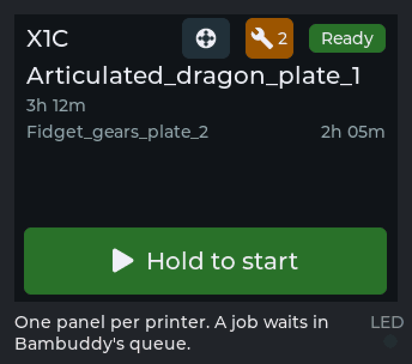

# Bambuddy Panel

Bambuddy Panel shows one printer’s status and queue on an ESP32 touchscreen. It connects to your
[Bambuddy server](https://github.com/maziggy/bambuddy) over WiFi.

While a print runs, the panel shows progress, time remaining and temperatures. At the printer you
can pause or resume a job, record a print outcome, confirm plate clearance, assign an inventory
spool or mark maintenance done. Available actions depend on the printer, Bambuddy settings and API
key permissions.

## Installation and documentation

The ESP32-2432S028R with an ST7789 display (`cyd-st7789`) has hardware test coverage for the
display, touch calibration, backlight, WiFi and Bambuddy setup, printer status and filament slots.
The other nine board profiles have compile checks only. Some printer commands still await end-to-end
testing.

1. [Identify your board and display controller](docs/boards.md). The ESP32-2432S028R comes in two
   variants that use different firmware.
2. [Flash and configure the panel](docs/get-started.md) with a USB data cable, a 2.4 GHz WiFi
   network and a Bambuddy API key. PlatformIO can install the firmware from source.
3. [Use the panel](docs/using.md) or [update an installed panel](docs/updating.md) over WiFi.

The [documentation site](https://loidolt.github.io/bambuddy-panel/) also covers
[troubleshooting](docs/troubleshooting.md), [security](docs/security.md) and the
[Bambuddy API calls](docs/api.md).

## Development and support

With PlatformIO installed, run `pio test -e test` for the native tests. The desktop simulator needs
SDL2 and libcurl. Start it with `pio run -e sim -t exec` to explore the screens with sample data.

For build instructions, screenshots or new board profiles, see the
[development guide](docs/development.md) and [board contributor guide](boards/README.md).

Bambuddy Panel is an independent community project. Report panel issues in
[this repository](https://github.com/loidolt/bambuddy-panel/issues/new/choose). See
[CONTRIBUTING.md](CONTRIBUTING.md) for patch and hardware reports and [SECURITY.md](SECURITY.md) for
private reports.

## License

Panel code is available under the [MIT license](LICENSE). Bundled icons and libraries have their own
[licenses and credits](THIRD_PARTY.md).
