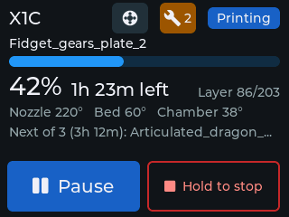
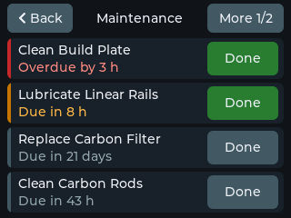

# Bambuddy Panel

A small touch panel that sits next to a 3D printer and shows what
[Bambuddy](https://github.com/maziggy/bambuddy) knows about it, with the few actions you want
while standing there. No phone, no browser tab.

One panel per printer. It runs on the inexpensive ESP32-2432S028R ("Cheap Yellow Display") and
talks only to your Bambuddy server over WiFi, never to the printer or to any cloud, so it works
with every printer Bambuddy supports.

| Printing | Print finished | Outcome question | Maintenance |
|---|---|---|---|
|  |  |  |  |

*Screenshots are from the simulator, at the panel's real 320x240.*

> **Status: early.** Everything here builds, the logic is unit-tested and the screens run in the
> simulator, but the firmware has **not yet run on a real board**, and none of its commands has
> been sent to a real Bambuddy yet. Expect rough edges until this note goes away.

## What it does

The buttons follow the printer's state:

| Printer state | Buttons |
|---|---|
| Printing | Pause, Stop (hold), Light |
| Paused | Resume, Stop (hold), Light |
| Finished, and the print was started with *Ask for outcome* | Thumbs up, Thumbs down, Later |
| Finished or failed, plate not yet cleared, and Bambuddy's *Require plate clear* is on | Plate is clear (hold), Light |
| Error | Clear error, Light |
| Idle, the next job for this printer waits for a manual start | Start (hold), Light |
| Idle | Light |

When Bambuddy has held back queued jobs because a print failed, a **Resume queue** button joins
the Error and Idle buttons.

- **Hold** buttons need 1.5 seconds, so a stray touch can't stop a print or start one on a dirty plate.
- The **outcome question** comes before "plate is clear" on purpose: Bambuddy can be set to
  record an unanswered print as good when the plate is cleared. It is asked, as on Bambuddy's own
  printer card, only for prints that completed. **Later** puts it off for that print and goes on
  to the plate. If the API key may not record the answer, the panel says so once and stops asking.
- **Plate is clear** is offered only when Bambuddy's *Require plate clear* setting is on (as in
  Bambuddy's own UI), and also while the printer is switched off, as it is with Auto Power Off.
- **Start** is offered only for a job assigned to this printer. A job queued for "any X1C" shows
  as next, but Bambuddy decides which printer gets it.
- The **wrench** in the header opens the printer's maintenance tasks, most urgent first. It turns
  red with a count when tasks are due and amber when some are due soon. Hold **Done** to mark a
  task performed. The list returns to the status screen after 30 seconds without a touch.
- The **LED** on the back blinks when someone should come over: cyan for the outcome question,
  green for "clear the plate", yellow for paused, red for an error, purple when Bambuddy can't be
  reached. Solid blue while printing.
- The panel's fonts only have plain ASCII, so names are shown without accents (*Jürgen* becomes
  *Jurgen*); other scripts show as `?`.

## Hardware

One board so far, the ESP32-2432S028R: ESP32-WROOM, 2.8" 320x240 display, resistive touch, no
PSRAM. Sold under many names. Two display chips are common and both are supported:

| Variant | Build |
|---|---|
| ST7789 display (often the board with two USB ports) | `cyd-st7789` (default) |
| ILI9341 display (often the board with one USB port) | `cyd-ili9341` |

The USB ports are only a hint; sellers mix them. If the picture stays white or garbled, try the
other build.

Power it from any 5 V USB supply.

Other boards and screen sizes: each board is one file in `boards/`, and the screens scale
themselves to the size they find. [boards/README.md](boards/README.md) says how to add one.

## Build and flash

Needs [PlatformIO](https://platformio.org/install/cli).

```bash
pio run -t upload
```

```bash
pio run -e cyd-ili9341 -t upload
```

```bash
pio device monitor
```

If the picture is wrong on first boot, change one flag in `boards/cyd-2432s028r.ini` under your
variant:

| Symptom | Change |
|---|---|
| Red and blue swapped | `TFT_RGB_ORDER=TFT_BGR` to `TFT_RGB` |
| Colours look like a negative | `TFT_INVERSION_OFF` to `TFT_INVERSION_ON` |
| Touch lands in the wrong place | Recalibrate (see below) |

Once a minute the serial monitor shows the free memory and the background task's spare stack
(`[health] ...`), which helps when reporting a problem.

## Set up a panel

1. In Bambuddy, Settings > API keys, create a key for this panel. Bambuddy ticks most
   permissions for a new key; untick everything the table doesn't list.

   | Permission | Needed for |
   |---|---|
   | Read Status | Everything shown |
   | Control Printer | Pause, resume, stop, plate is clear, light, clear error |
   | Manage Queue | Start the next job, resume the queue |
   | Manage Archives (optional) | Answering the outcome question |
   | Manage Maintenance (optional) | Marking maintenance tasks done |

   A key never does more than the user who owns it may do. In particular:

   - **Resume queue** needs an owner who may manage *all* queue jobs.
   - **Start** works on the owner's own jobs, or on anyone's if the owner may manage all queue
     jobs. Jobs waiting for review need someone who may start unreviewed jobs.
   - **Answering the outcome question** works on the owner's own prints, or on anyone's if the
     owner may edit all archives.

   Without a permission the button answers "Not allowed (API key)"; the rest works.

   Bambuddy's settings page can't limit a key to one printer (1.3.x); its API can, with
   `PATCH /api/v1/api-keys/{key_id}` and the body `{"printer_ids": [<printer id>]}`.
2. Find the printer's id: `GET /api/v1/printers/` lists each printer with its `id`.
3. Power the panel. A new panel first asks you to tap four crosses (touch calibration), then
   opens the setup network `BambuddyPanel-Setup` and shows its password on the screen. Join it
   from a phone, open `192.168.4.1`, and enter your WiFi, the Bambuddy URL (`http://host:port`;
   https isn't supported), the API key and the printer id.

To change settings later, touch the screen while it says "Starting":

- let go when asked: WiFi and Bambuddy setup (leave the key blank to keep the saved one)
- keep holding about four seconds: touch calibration

The setup network only opens on a new panel or when asked for this way. If the WiFi is down
when the panel starts, it says so and keeps trying; it doesn't open the setup network.

## Security

- **API key.** Stored in the panel's flash, which isn't encrypted: anyone who takes the panel
  away can read it. It travels over plain HTTP on your LAN, where anyone on that network can
  read it too. Give it only the permissions above, limit it to one printer, and delete it in
  Bambuddy if a panel goes missing.
- **Setup network.** Open only while you set the panel up, at most 10 minutes. It has a
  password of eight random digits, new every time and shown only on the panel's screen. The
  setup page never shows the saved API key, and the extra pages of the setup library
  (firmware upload, erase, restart, device info) are switched off.
- **Updates over WiFi** are off unless you build them in with a password (see below).

## Simulator

The panel's screens, its JSON reading, its requests and its polling round run on the desktop in
a window the size of the panel's screen (320x240, shown at 2x), so screens can be worked on
without flashing a board. Needs SDL2
(macOS: `brew install sdl2`; Debian/Ubuntu: `apt install libsdl2-dev`).

```bash
pio run -e sim -t exec
```

Left/Right switch between made-up printer states (`src/sim/scenarios.cpp`), the mouse is the
finger, Q quits. Buttons change the made-up state and print the request the panel would send;
nothing is sent anywhere. The window title shows the state name and the LED colour.

A PNG of every state, into `shots/`:

```bash
./tools/shots.sh
```

Another screen size, for a board that isn't 320x240. `--size` works with the window and with
`--live` too:

```bash
./tools/shots.sh 480x320
```

```bash
.pio/build/sim/program --size 480x320
```

A real printer, read-only (the buttons send nothing):

```bash
BAMBUDDY_URL=http://host:3700 BAMBUDDY_KEY=... BAMBUDDY_PRINTER=1 .pio/build/sim/program --live
```

The simulator shows layout, fonts, text cut-off and 16-bit colour faithfully, and runs LVGL with
the panel's memory size and strip-by-strip drawing. It stands in for the display and touch
drivers, the LED, HTTP (curl instead of the ESP32's client, in the window's own thread) and, in
made-up mode, Bambuddy itself. It does not show the real panel's weaker contrast and viewing
angle, the imprecision of resistive touch, redraw speed, the boot and setup screens' timing, or
anything about WiFi.

## Tests

```bash
pio test -e test
```

Covers the parts with no hardware in them: reading Bambuddy's JSON (status, queue, outcome
question, maintenance, settings), the requests each button sends, the polling round, which
screen and buttons each printer state gets, the text on screen, and the touch calibration maths.

CI runs the tests, builds the firmware for every board (also with updates over WiFi turned on),
checks that `src/icons.c` and the README's screenshots are up to date, draws the screens at a
second size, and fails on any warning in the panel's own code.

## Updates over WiFi

Off unless built with a password of at least 8 characters (the build fails on a shorter one).
Put it in `platformio_override.ini` (ignored by git, read when it is there), as a build of your
own on top of your board's:

```ini
[env:my-panel]
extends = env:cyd-st7789
build_flags = ${env:cyd-st7789.build_flags} -DOTA_PASSWORD=\"change-me-please\"
upload_protocol = espota
upload_port = bambuddy-panel-1.local
upload_flags = --auth=change-me-please
```

```bash
pio run -e my-panel -t upload
```

The password is checked with a challenge, so it doesn't cross the network, but the firmware
itself is neither encrypted nor signed, and the password is in the firmware file.

## How it talks to Bambuddy

REST only, with the `X-API-Key` header. Written against Bambuddy 1.3.1.

| When | Request |
|---|---|
| Every ~4 s | `GET /api/v1/printers/{id}/status` |
| Every ~4 s | `GET /api/v1/queue/?status=pending,skipped&printer_id={id}` |
| Every ~4 s, not while printing | `GET /api/v1/archives/last-per-printer` |
| Every 60 s | `GET /api/v1/maintenance/printers/{id}` |
| Every 60 s | `GET /api/v1/settings/` (only *Require plate clear* is kept) |
| Pause, resume, stop | `POST /api/v1/printers/{id}/print/pause` · `resume` · `stop` |
| Plate is clear | `POST /api/v1/printers/{id}/clear-plate` |
| Light | `POST /api/v1/printers/{id}/chamber-light?on=true` or `false` |
| Clear error | `POST /api/v1/printers/{id}/hms/clear` |
| Start | `POST /api/v1/queue/{item}/start` |
| Resume queue | `POST /api/v1/queue/printer/{id}/resume` |
| Thumbs | `PATCH /api/v1/archives/{id}` with `user_verdict`, `user_verdict_source` and `run_id` |
| Task done | `POST /api/v1/maintenance/items/{id}/perform` |

Responses are read through a field filter straight off the socket, so the panel never holds a
whole status document in memory. A button sends the ids the screen showed when it was pressed,
and runs between two reads rather than after a whole round.

## Layout

| Path | Job |
|---|---|
| `src/main.cpp` | Boot, WiFi and setup portal, main loop |
| `src/bambuddy.*` | Background task: HTTP, polls Bambuddy, sends commands |
| `src/poller.*` | One round of reading Bambuddy; shared with the simulator and the tests |
| `src/bambuddy_api.*` | The requests each command sends, and the wording of results |
| `src/bambuddy_parse.*` | JSON to state |
| `src/ui_logic.*` | Which screen and buttons each state gets, and the text on it |
| `src/ui.cpp`, `src/ui_tasks.cpp` | Drawing: the status, message and calibration screens; the maintenance screen |
| `src/ui_layout.cpp` | Fits the screens to the panel's size: the unit grid and the text sizes |
| `src/display.*` | The board's drivers tied to LVGL: drawing, touch, backlight, LED |
| `src/drivers/` | One file per panel or touch chip; the board picks |
| `src/calibrate.*`, `src/touch_cal.*` | Touch calibration: the screen flow, and the maths |
| `src/settings.*` | Settings kept in flash |
| `src/icons.*` | Icons, made by `tools/make_icons.py` from the SVGs in `tools/icons/` |
| `src/board.h` | Checks the board's description is complete |
| `boards/` | One file per board: chip, pins, screen size, drivers. [How to add one](boards/README.md) |
| `platformio.ini` | What every build shares; the simulator and test builds |
| `src/sim/` | Desktop simulator and its made-up states |
| `test/` | Unit tests |

## Not done yet

- First run on real hardware, and fixing what that turns up.
- Lock or PIN on the controls.
- Queue list screen; backlight dimming from the light sensor.
- Prebuilt firmware and a browser flasher, so nobody needs PlatformIO to try it.
- A printable case.

## License

MIT, see [LICENSE](LICENSE). Icons and libraries: [THIRD_PARTY.md](THIRD_PARTY.md).

Bambuddy Panel is an independent community project. It is not part of, or endorsed by, Bambuddy
or Bambu Lab.
