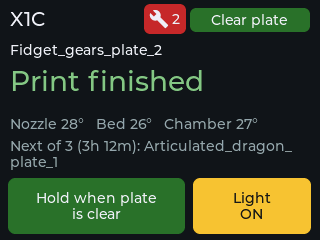

# Bambuddy Panel

A small touch panel that sits next to a 3D printer and shows what
[Bambuddy](https://github.com/maziggy/bambuddy) knows about it, with the few actions you want
while standing there. No phone, no browser tab.

One panel per printer. It runs on the inexpensive ESP32-2432S028R ("Cheap Yellow Display") and
talks only to your Bambuddy server over WiFi, never to the printer or to any cloud, so it works
with every printer Bambuddy supports.

| Printing | Print finished | Outcome question | Maintenance |
|---|---|---|---|
|  |  |  |  |

*Screenshots are from the simulator, at the panel's real 320x240.*

> **Status: early.** It runs on one board, the ESP32-2432S028R with the ST7789 display
> (`cyd-st7789`): display, touch calibration, WiFi and Bambuddy setup, status, and the filament
> slots of a real printer. The buttons' commands (pause, stop, plate is clear, start and the
> rest) are unit-tested against Bambuddy's API as documented, but **have not all been pressed
> against a real Bambuddy yet**, and no other board has been flashed. Expect rough edges until
> this note goes away.

## What it does

The panel offers what only Bambuddy can do, and the few printer controls that are slow to reach
on a printer's own screen. Everything else (temperatures to set, speed, the light, the AMS) is
left to the printer.

The screen follows the printer's state. A chip in the corner names it; the buttons are what
can be done about it:

| State | The screen shows | Buttons |
|---|---|---|
| Preparing | The stage it is at ("Auto bed leveling") | Pause, Stop (hold) |
| Printing | Progress, time left, layer, temperatures, what is next | Pause, Stop (hold) |
| Paused | Where it paused, and the error if there is one | Resume, Stop (hold) |
| Finished, and the print was started with *Ask for outcome* | "How did it print?" | Thumbs up, Thumbs down, Skip |
| Finished or failed, plate not yet cleared, and Bambuddy's *Require plate clear* is on | The result and the next two jobs | Plate is clear (hold) |
| Error | The error's text; with several, a tap shows the next | Clear error |
| Ready: the next job for this printer waits for a manual start | The job, how long it takes, who queued it, and why Bambuddy holds it back if it does | Start (hold) |
| Queue held: Bambuddy held jobs back because a print failed | How many | Resume queue (hold) |
| Idle | The next three jobs, and what the first is waiting for | none |

A **Resume queue** button also joins Error and Ready when jobs are held.

- **Hold** buttons fill from the left over 1.5 seconds and act when full; letting go early does
  nothing. Anything that starts a print or can't be undone is a hold, so a stray touch can't
  stop a print or start one on a dirty plate.
- A pressed button says what is under way ("Stopping...") and nothing else can be pressed
  until Bambuddy has answered. A command that fails says why in a red band across the top,
  which stays six seconds or until it is tapped: "API key lacks Manage Queue", "Not enough
  filament loaded".
- The **outcome question** comes before "plate is clear" on purpose: Bambuddy can be set to
  record an unanswered print as good when the plate is cleared. It is asked, as on Bambuddy's own
  printer card, only for prints that completed. **Skip** passes it for that print and goes on to
  the plate; it can still be answered in Bambuddy. If the API key may not record the answer,
  the panel says so once and stops asking.
- **Plate is clear** is offered only when Bambuddy's *Require plate clear* setting is on (as in
  Bambuddy's own UI), and also while the printer is switched off, as it is with Auto Power Off.
  When clearing the plate will start the next print, the button says so.
- **Start** is offered only for a job assigned to this printer. A job queued for "any X1C" shows
  as waiting, with a line saying Bambuddy picks the printer.
- The **spool** in the header opens the printer's filament slots: what the printer says is in
  each, and which spool of Bambuddy's inventory is assigned to it, with what is left on it.
  **Change** or **Assign** on a slot lists the inventory's spools, starting with the material
  that is in the slot; the button at the top steps through the other materials. Hold **Assign**
  on a spool to put it in the slot (Bambuddy then sets the slot up on the printer, and takes
  the spool out of any other slot it was in); hold **Remove** to take the slot's spool out.
  The spool only shows for a printer that reports slots. This uses Bambuddy's own inventory;
  Spoolman is not supported yet.
- The **wrench** in the header opens the printer's maintenance tasks, most urgent first. It
  turns amber with a count when tasks are due and gets an amber outline when some are due
  soon. Hold **Mark done** to mark a task performed. The list returns to the status screen
  after a minute without a touch. The **gear** on that screen (hold) opens the panel's settings.
- The **LED** on the back blinks when someone should come over: cyan for the outcome question,
  green for "clear the plate", yellow for paused or a held queue, red for an error, purple when
  Bambuddy can't be reached. Solid blue while printing.
- The **backlight** dims to about a third after a minute without a touch while nothing wants
  anyone (printing, idle, printer offline). The first touch on a dimmed screen only brightens it.
- **Error** means what Bambuddy's own printer card counts as a problem. Notices the printer
  keeps for a whole print ("the top cover is open") and codes Bambu publishes no text for are
  left out, as they are there.
- One request Bambuddy doesn't answer greys the chip: what is on screen may be a few seconds
  old. From the second in a row a red band says for how long there has been no answer, the
  last status stays under it, and nothing can be pressed. After five minutes, or at once when
  Bambuddy refuses the key or the address can't work, a screen says why and offers
  **Open settings**.
- The panel's fonts only have plain ASCII, so names are shown without accents (*Jürgen* becomes
  *Jurgen*); other scripts show as `?`.

## Hardware

Written for the ESP32-2432S028R: ESP32-WROOM, 2.8" 320x240 display, resistive touch, no PSRAM.
Sold under many names. Two display chips are common and both are supported:

| Variant | Build |
|---|---|
| ST7789 display (often the board with two USB ports) | `cyd-st7789` (default); the one build that has run on its board |
| ILI9341 display (often the board with one USB port) | `cyd-ili9341`; not flashed yet |

The USB ports are only a hint; sellers mix them. If the picture stays white or garbled, try the
other build.

Power it from any 5 V USB supply.

### Other boards

Its relatives have profiles too. They build, and their pins come from board definitions other
projects use, but **none has been flashed yet**; [boards/README.md](boards/README.md) lists
what to change if the picture or the touch comes out wrong.

| Board | Screen | Touch | Build |
|---|---|---|---|
| ESP32-2432S024R | 2.4" 320x240 | resistive | `esp32-2432s024r` |
| ESP32-2432S024C | 2.4" 320x240 | capacitive | `esp32-2432s024c` |
| ESP32-2432S032R | 3.2" 320x240 | resistive | `esp32-2432s032r` |
| ESP32-2432S032C | 3.2" 320x240 | capacitive | `esp32-2432s032c` |
| ESP32-3248S035R | 3.5" 480x320 | resistive | `esp32-3248s035r` |
| ESP32-3248S035C | 3.5" 480x320 | capacitive | `esp32-3248s035c` |
| Guition JC2432W328C | 2.8" 320x240 | capacitive | `jc2432w328c` |
| WT32-SC01 | 3.5" 480x320 | capacitive | `wt32-sc01` |

A board with capacitive touch has no touch calibration: a touch at start-up goes straight to
WiFi and Bambuddy setup. A board without a status LED shows the same things on screen only.

Each board is one file in `boards/`, and the screens scale themselves to the size they find.
[boards/README.md](boards/README.md) says how to add one.

## Flash a release

The [releases](https://github.com/loidolt/bambuddy-panel/releases) have a firmware file for
every build in the tables above. For a board that doesn't run Bambuddy Panel yet, take your
build's `-full.bin` and write it at address 0x0, with [esptool](https://docs.espressif.com/projects/esptool/)
(`pip install esptool`):

```bash
esptool.py --chip esp32 write_flash 0x0 bambuddy-panel-0.1.0-cyd-st7789-full.bin
```

Any other ESP32 flashing tool does as well, as long as it writes the file at 0x0. A `-full.bin`
also clears the panel's settings and touch calibration.

### Updating

A panel that runs Bambuddy Panel updates without USB, and keeps its settings and touch
calibration:

1. Download your build's `-app.bin` from the releases (not the `-full.bin`). The settings page
   names the build the panel runs.
2. Open the panel's settings page: the wrench, then hold the **gear**
   ([Set up a panel](#set-up-a-panel)).
3. Under **Update firmware**, choose the file. The code on the panel's screen is needed, as for
   any change. The panel says "Updating", then restarts with the new firmware; it takes about
   a minute.

The panel refuses a file built for another board, a `-full.bin`, and anything that isn't
Bambuddy Panel firmware, and keeps running what it had. If the upload is cut off, it does too.

The panel never fetches firmware itself; it still talks only to your Bambuddy. Over USB, the
same file goes to 0x10000:

```bash
esptool.py --chip esp32 write_flash 0x10000 bambuddy-panel-0.1.1-cyd-st7789-app.bin
```

That is also the way back if a new firmware starts but doesn't work: the panel doesn't return
to the old one by itself.

Released firmware has pushed updates over WiFi (ArduinoOTA) switched off; for those, build your
own (below).

## Build and flash

Needs [PlatformIO](https://platformio.org/install/cli).

```bash
pio run -t upload
```

```bash
pio run -e cyd-ili9341 -t upload
```

```bash
pio device monitor
```

If the picture is wrong on first boot, change one flag in `boards/cyd-2432s028r.ini` under your
variant. `cyd-st7789` has both flags already; under `cyd-ili9341` the flag isn't there yet and
is added as a new line.

| Symptom | `cyd-st7789`: change | `cyd-ili9341`: add |
|---|---|---|
| Red and blue swapped | `TFT_RGB_ORDER=TFT_BGR` to `TFT_RGB` | `-DTFT_RGB_ORDER=TFT_BGR` |
| Colours look like a negative | `TFT_INVERSION_OFF` to `TFT_INVERSION_ON` | `-DTFT_INVERSION_ON=1` |
| Touch lands in the wrong place | Recalibrate (see below) | Recalibrate (see below) |

The serial monitor shows the firmware's version at start-up (`[boot] ...`) and, once a minute,
the version, the free memory and the background task's spare stack (`[health] ...`), which
helps when reporting a problem. The settings page has the version at its foot. A build of your
own is version `dev`.

## Set up a panel

1. In Bambuddy, Settings > API keys, create a key for this panel. Bambuddy ticks most
   permissions for a new key; untick everything the table doesn't list.

   | Permission | Needed for |
   |---|---|
   | Read Status | Everything shown |
   | Control Printer | Pause, resume, stop, plate is clear, clear error |
   | Manage Queue | Start the next job, resume the queue |
   | Manage Archives (optional) | Answering the outcome question |
   | Manage Maintenance (optional) | Marking maintenance tasks done |
   | Manage Inventory (optional) | Assigning a spool to a slot, or taking it out |

   A key never does more than the user who owns it may do. In particular:

   - **Resume queue** needs an owner who may manage *all* queue jobs.
   - **Start** works on the owner's own jobs, or on anyone's if the owner may manage all queue
     jobs. Jobs waiting for review need someone who may start unreviewed jobs.
   - **Answering the outcome question** works on the owner's own prints, or on anyone's if the
     owner may edit all archives.

   Without a permission the panel says which one the key lacks; the rest works.

   Bambuddy's settings page can't limit a key to one printer (1.3.x); its API can, with
   `PATCH /api/v1/api-keys/{key_id}` and the body `{"printer_ids": [<printer id>]}`.
2. You don't need to look up the printer's id: the panel's settings page lists the printers
   the key may see. (By hand: `GET /api/v1/printers/` lists each printer with its `id`.)
3. Power the panel. A new panel first asks you to tap four crosses (touch calibration), then
   opens the setup network `BambuddyPanel-Setup` and shows a QR code for it, with its name and
   password beside it. Scan the code with a phone, or join the network by hand, and choose
   your WiFi in the page that opens (or open `192.168.4.1`). That page asks for the WiFi only.
4. Once it's on your WiFi, the panel shows a second QR code, with its address and a code beside
   it, e.g. `192.168.1.80` and `abcd-efgh`. Scan it, or open that address in any browser on the
   same network and type the code. Enter the Bambuddy URL (`http://host:port`; https isn't
   supported) and the API key. With those in, the page tries the key with Bambuddy, without
   saving, and turns the printer field into a list of the printers the key may see. The page
   also explains which permissions the key needs. It's an ordinary web page, so you can switch
   away to copy the key and come back. **Save** checks the settings with Bambuddy straight away
   and says what's wrong if it doesn't accept them (or, if Bambuddy is only down for now, **Use
   these settings anyway**).

To change settings later, open the maintenance screen (the wrench) and hold the **gear**. The
panel restarts into its settings screen, with a new code. From there:

- the settings page again (leave the key blank to keep the saved one; with a new Bambuddy URL
  the key has to be entered again). It has a **Change WiFi** button, which forgets the WiFi and
  restarts into the setup network. If the saved WiFi can't be joined, the setup network opens
  instead.
- **Calibrate touch**, on panels with resistive touch
- **Cancel**, back to normal running with nothing changed

When Bambuddy refuses the key or can't be reached for five minutes, the screen that says so
has an **Open settings** button that does the same.

If the touch is too far off to press anything, touch the screen while it says "Starting", just
after power-on: let go when asked for the settings screen, or keep holding about four seconds
for touch calibration.

The settings page and the setup network only open on a new panel or when asked for in one of
these ways. If the WiFi is down when a panel that's set up starts, it says so and keeps trying.

## Security

- **API key.** Stored in the panel's flash, which isn't encrypted: anyone who takes the panel
  away can read it. It travels over plain HTTP on your LAN, where anyone on that network can
  read it too, and can then send the panel's commands (stop, pause, start) themselves or show
  the panel a status that isn't true. Give it only the permissions above, limit it to one printer, and delete it in
  Bambuddy if a panel goes missing.
- **Setup network.** Open only while you set up the WiFi; it closes after 10 minutes without
  use. It has a password of twelve random letters and digits, new every time and shown only on
  the panel's screen. The extra pages of the setup library (firmware upload, erase, restart,
  device info) are switched off.
- **Settings page.** Served on your network only during setup or after a touch at start-up,
  and closed again after 10 minutes without a Save once the panel is set up. Every change
  needs the code shown on the panel's screen (the QR code there carries it too), so only
  someone who can see the panel can make one; a wrong code costs a second, and after ten the panel shows a new one. The page is plain
  HTTP, so what's typed into it crosses your network as readable as the panel's own requests.
  It never shows the saved API key, and the key is only kept for the Bambuddy URL it was saved
  with: change the URL and it must be entered again, so nobody at the panel can have it sent
  to a server of their own.
- **Firmware update.** The settings page takes a new firmware file, so it is open only when
  that page is, and needs the same code: whoever can see the panel's screen can put other
  firmware on it. The file is not signed. The panel checks that it is an application built for
  this board, which guards against a wrong file, not against a tampered one; download it from
  the releases yourself and compare it with `SHA256SUMS.txt` if in doubt. The upload is plain
  HTTP like the rest of the page. There is no automatic way back: firmware that starts but
  hangs needs USB to replace.
- **Pushed updates over WiFi** (ArduinoOTA) are off unless you build them in with a password
  (see below).

## Simulator

The panel's screens, its JSON reading, its requests and its polling round run on the desktop in
a window the size of the panel's screen (320x240, shown at 2x), so screens can be worked on
without flashing a board. Needs SDL2
(macOS: `brew install sdl2`; Debian/Ubuntu: `apt install libsdl2-dev`).

```bash
pio run -e sim -t exec
```

Left/Right switch between made-up printer states (`src/sim/scenarios.cpp`), the mouse is the
finger, Q quits. Buttons change the made-up state and print the request the panel would send;
nothing is sent anywhere. The window title shows the state name and the LED colour.

A PNG of every screen the panel can show, into `shots/`: each state, the maintenance lists,
pressed and held buttons, every toast, and the start-up, setup, offline and calibration screens.
`shots/targets/` has the same pictures with each touch target framed and measured, and
`shots/checks.txt` lists text that was cut off and targets under 7 mm on the smallest panel
with that resolution:

```bash
./tools/shots.sh
```

All of that for every screen size a board has, plus the settings web page in each of its
states, on one page to scroll through (`shots/index.html`):

```bash
./tools/shots.sh all
```

Another screen size, for a board that isn't 320x240. `--size` works with the window and with
`--live` too:

```bash
./tools/shots.sh 480x320
```

```bash
.pio/build/sim/program --size 480x320
```

A real printer, read-only (the buttons send nothing):

```bash
BAMBUDDY_URL=http://host:3700 BAMBUDDY_KEY=... BAMBUDDY_PRINTER=1 .pio/build/sim/program --live
```

The simulator shows layout, fonts, text cut-off and 16-bit colour faithfully, and runs LVGL with
the panel's memory size and strip-by-strip drawing. It stands in for the display and touch
drivers, the LED, HTTP (curl instead of the ESP32's client, in the window's own thread) and, in
made-up mode, Bambuddy itself. It does not show the real panel's weaker contrast and viewing
angle, the imprecision of resistive touch, redraw speed, the boot and setup screens' timing, or
anything about WiFi.

## Tests

```bash
pio test -e test
```

Covers the parts with no hardware in them: reading Bambuddy's JSON (status, queue, outcome
question, maintenance, settings), the requests each button sends, the polling round, which
screen and buttons each printer state gets, the text on screen, and the touch calibration maths.

The tests run with AddressSanitizer and UBSan, so a write past the end of a text field fails
them.

CI runs the tests, builds the firmware for every board (also with updates over WiFi turned on),
checks that `src/icons.c` and the README's screenshots are up to date, and draws the screens at
a second size, which shows that nothing crashes there and every button the screenshots press
still exists; how the screens look at that size is not compared with anything. A warning in the
panel's own code (`src/`) fails every build; the test file itself is compiled without that.

A tag like `v0.1.0` builds every board as that version and puts the firmware files and the
license texts into a draft release (`.github/workflows/release.yml`), to be looked over and
published by hand.

## Updates over WiFi

This is for development: pushing a build from PlatformIO. To update a panel with a release, see
[Updating](#updating). Off unless built with a password of at least 8 characters (the build fails on a shorter one).
Put it in `platformio_override.ini` (ignored by git, read when it is there), as a build of your
own on top of your board's:

```ini
[env:my-panel]
extends = env:cyd-st7789
build_flags = ${env:cyd-st7789.build_flags} -DOTA_PASSWORD=\"change-me-please\"
upload_protocol = espota
upload_port = bambuddy-panel-1.local
upload_flags = --auth=change-me-please
```

```bash
pio run -e my-panel -t upload
```

The password is checked with a challenge, so it doesn't cross the network, but the firmware
itself is neither encrypted nor signed, and the password is in the firmware file.

## How it talks to Bambuddy

REST only, with the `X-API-Key` header. Written against Bambuddy 1.3.1. The panel names itself
in `User-Agent` (`bambuddy-panel/0.1.0`), so Bambuddy's log shows which firmware asked.

| When | Request |
|---|---|
| Every ~4 s | `GET /api/v1/printers/{id}/status` |
| Every ~4 s | `GET /api/v1/queue/?status=pending,skipped,printing&printer_id={id}` |
| Every ~4 s, not while printing | `GET /api/v1/archives/last-per-printer` |
| Every 60 s | `GET /api/v1/maintenance/printers/{id}` |
| Every 60 s | `GET /api/v1/settings/` (only *Require plate clear* is kept) |
| Every 60 s, for a printer with slots | `GET /api/v1/inventory/assignments?printer_id={id}` |
| When the spool list is opened | `GET /api/v1/inventory/spools` (the first 150 are kept) |
| Pause, resume, stop | `POST /api/v1/printers/{id}/print/pause` · `resume` · `stop` |
| Plate is clear | `POST /api/v1/printers/{id}/clear-plate` |
| Clear error | `POST /api/v1/printers/{id}/hms/clear` |
| Start | `POST /api/v1/queue/{item}/start` |
| Resume queue | `POST /api/v1/queue/printer/{id}/resume` |
| Thumbs | `PATCH /api/v1/archives/{id}` with `user_verdict`, `user_verdict_source` and `run_id` |
| Task done | `POST /api/v1/maintenance/items/{id}/perform` |
| Assign a spool | `POST /api/v1/inventory/assignments` with `spool_id`, `printer_id`, `ams_id`, `tray_id`, `move` |
| Remove a spool | `DELETE /api/v1/inventory/assignments/{printer}/{ams}/{tray}` |

Responses are read through a field filter straight off the socket, so the panel never holds a
whole status document in memory. A button sends the ids the screen showed when it was pressed,
and runs between two reads rather than after a whole round.

## Layout

| Path | Job |
|---|---|
| `src/main.cpp` | Boot, WiFi and setup portal, main loop |
| `src/bambuddy.*` | Background task: HTTP, polls Bambuddy, sends commands |
| `src/poller.*` | One round of reading Bambuddy; shared with the simulator and the tests |
| `src/bambuddy_api.*` | The requests each command sends, and the wording of results |
| `src/bambuddy_parse.*` | JSON to state |
| `src/ui_logic.*` | Which screen and buttons each state gets, and the text on it |
| `src/ui.cpp`, `src/ui_tasks.cpp` | Drawing: the status, message and calibration screens; the maintenance screen |
| `src/ui_layout.cpp` | Fits the screens to the panel's size: the unit grid and the text sizes |
| `src/display.*` | The board's drivers tied to LVGL: drawing, touch, backlight, LED |
| `src/drivers/` | One file per panel or touch chip; the board picks |
| `src/calibrate.*`, `src/touch_cal.*` | Touch calibration: the screen flow, and the maths |
| `src/settings.*` | Settings kept in flash |
| `src/setup_web.cpp`, `src/setup_page.*` | The settings page: the web server with the code check and the firmware upload; the page's text |
| `src/fw_check.*` | Checks an uploaded firmware file: an application, and built for this board |
| `src/icons.*` | Icons, made by `tools/make_icons.py` from the SVGs in `tools/icons/` |
| `src/board.h` | Checks the board's description is complete |
| `src/version.h` | The firmware's version: `dev`, or the tag a release was built from |
| `boards/` | One file per board: chip, pins, screen size, drivers. [How to add one](boards/README.md) |
| `platformio.ini` | What every build shares; the simulator and test builds |
| `src/sim/` | Desktop simulator and its made-up states |
| `test/` | Unit tests |

## Not done yet

- Every button pressed against a real Bambuddy, a first run of the boards other than
  `cyd-st7789`, and fixing what those turn up.
- Lock or PIN on the controls.
- Switching the printer on through its smart plug, and holding the next queued job back:
  both need checking against a running Bambuddy first (docs/ux-deep-dive-plan.md, 3.4).
- Spool assignment when Bambuddy keeps its spools in Spoolman.
- Accented letters (Latin-1 fonts); the finish time as a clock time.
- Backlight dimming from the light sensor.
- A browser flasher, so nobody needs a command line to try it.
- Signed firmware, and going back to the old firmware by itself when a new one doesn't work.
- Telling you that a newer release exists.
- A printable case.

## License

MIT, see [LICENSE](LICENSE). Icons and libraries: [THIRD_PARTY.md](THIRD_PARTY.md).

Bambuddy Panel is an independent community project. It is not part of, or endorsed by, Bambuddy
or Bambu Lab.
