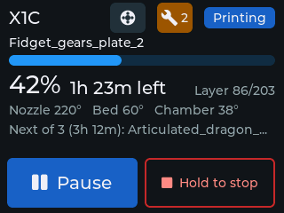
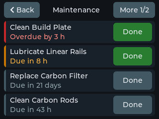
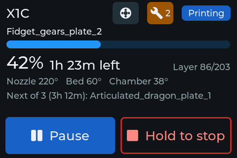
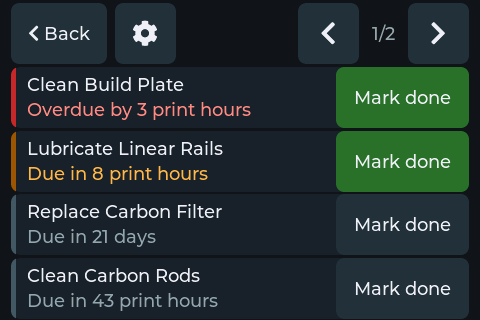
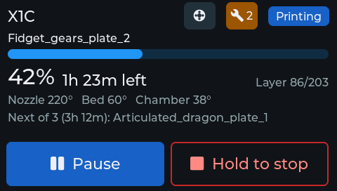
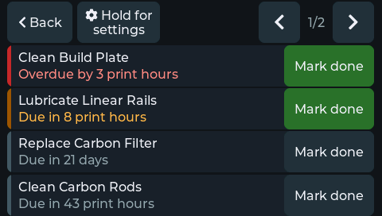
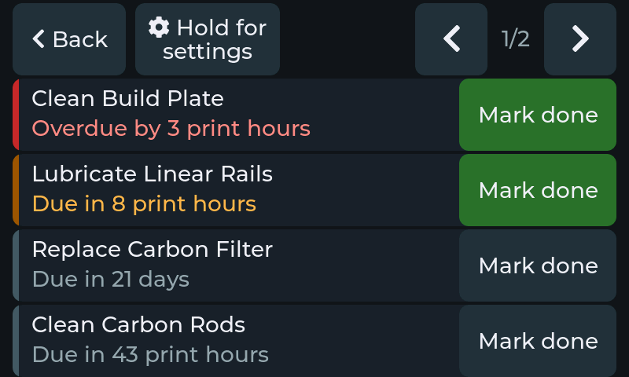

# Boards

Match the model number, display controller and touch type before flashing. The **build profile** is
the name used by PlatformIO (`pio run -e <profile>`) and in packaged firmware filenames.

## Available profiles

Hardware checks on the ESP32-2432S028R with the ST7789 display cover the display, touch calibration,
backlight, WiFi and Bambuddy setup, printer status and filament slots. The other nine profiles
compile in CI and still need hardware reports.

| Board | Display | Touch controller | Build profile |
|---|---|---|---|
| ESP32-2432S028R | 2.8″ 320×240 ST7789 | Resistive XPT2046 | `cyd-st7789` (default) |
| ESP32-2432S028R | 2.8″ 320×240 ILI9341 | Resistive XPT2046 | `cyd-ili9341` |
| ESP32-2432S024R | 2.4″ 320×240 ILI9341 | Resistive XPT2046 | `esp32-2432s024r` |
| ESP32-2432S024C | 2.4″ 320×240 ILI9341 | Capacitive CST820 | `esp32-2432s024c` |
| ESP32-2432S032R | 3.2″ 320×240 ST7789 | Resistive XPT2046 | `esp32-2432s032r` |
| ESP32-2432S032C | 3.2″ 320×240 ST7789 | Capacitive GT911 | `esp32-2432s032c` |
| ESP32-3248S035R | 3.5″ 480×320 ST7796 | Resistive XPT2046 | `esp32-3248s035r` |
| ESP32-3248S035C | 3.5″ 480×320 ST7796 | Capacitive GT911 | `esp32-3248s035c` |
| Guition JC2432W328C | 2.8″ 320×240 ST7789 | Capacitive CST820 | `jc2432w328c` |
| Wireless-Tag WT32-SC01 | 3.5″ 480×320 ST7796 | Capacitive FT6336 | `wt32-sc01` |

The ESP32-2432S028R is often sold as the “Cheap Yellow Display.” Two USB ports often indicate ST7789
and one often indicates ILI9341, but board revisions vary. Check the display specification if
available. If the picture stays white or garbled, try the other ESP32-2432S028R profile over USB.

Resistive boards calibrate at first boot. Capacitive boards use a fixed touch orientation. The
status screen works on boards with or without an RGB LED.

## If the picture or the touch is wrong

Start with the matching profile above. For resistive touch,
[recalibrate on the panel](troubleshooting.md#the-touch-lands-in-the-wrong-place) before changing
any build flags. To change a flag, edit the matching file in `boards/`, then
[rebuild and flash](development.md#build-and-flash).

| Symptom | Adjustment |
|---|---|
| Red and blue are swapped | Switch `TFT_RGB_ORDER` between `TFT_RGB` and `TFT_BGR`. The ST7789 CYD profile sets BGR. For the ILI9341 CYD profile, try adding `-DTFT_RGB_ORDER=TFT_BGR`. |
| Colours look like a negative | Switch between `TFT_INVERSION_ON` and `TFT_INVERSION_OFF`. On the ILI9341 CYD profile, try adding `-DTFT_INVERSION_ON=1`. |
| Picture is upside down | Change `PANEL_ROTATION` between 1 and 3. On capacitive boards, also adjust the touch mirroring as described in the profile. Resistive boards prompt for a new calibration. |
| Capacitive touch is mirrored | Toggle `TOUCH_MIRROR_X` or `TOUCH_MIRROR_Y` for the affected axis. |
| Capacitive touch gives no response | Check the chip and I²C pins. For CST820 or FT6336, check whether the board needs a different `TOUCH_I2C_ADDR`. |
| ILI9341 display is still garbled | Try changing `ILI9341_2_DRIVER` to `ILI9341_DRIVER`. |

[Submit a board report](https://github.com/loidolt/bambuddy-panel/issues/new?template=board.yml)
with the model, controller, firmware version, what worked and any flags you changed. To add a
profile or driver, follow the
[board contributor guide](https://github.com/loidolt/bambuddy-panel/blob/main/boards/README.md).

## Screen sizes

The interface scales from a 320×240 landscape layout. The screenshots below come from the desktop
simulator. The 480×272 and 800×480 layouts are simulator examples and have no corresponding firmware
profiles.

**320×240** · ESP32-2432S028R, ESP32-2432S024, ESP32-2432S032 and JC2432W328C

{ .screenshot }
{ .screenshot }

**480×320** · ESP32-3248S035 and WT32-SC01

{ .screenshot }
{ .screenshot }

**480×272** · Simulator only

{ .screenshot }
{ .screenshot }

**800×480** · Simulator only

{ .screenshot }
{ .screenshot }
