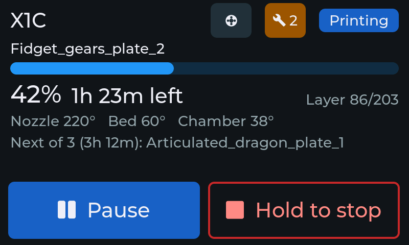

# Boards

Every board here is an ESP32 with an SPI display. The build name is what goes after `-e` when
building, and what a release's firmware file is called after.

## ESP32-2432S028R, the "Cheap Yellow Display"

Written for the ESP32-2432S028R: ESP32-WROOM, 2.8" 320x240 display, resistive touch, no PSRAM.
Sold under many names. Two display chips are common and both are supported:

| Variant | Build |
|---|---|
| ST7789 display (often the board with two USB ports) | `cyd-st7789` (default); the one build that has run on its board |
| ILI9341 display (often the board with one USB port) | `cyd-ili9341`; not flashed yet |

The USB ports are only a hint; sellers mix them. If the picture stays white or garbled, try the
other build.

Power it from any 5 V USB supply.

## Other boards

Its relatives have profiles too. They build, and their pins come from board definitions other
projects use, but **none has been flashed yet**; what to change if the picture or the touch comes out
wrong is [below](#if-the-picture-or-the-touch-is-wrong).

| Board | Screen | Touch | Build |
|---|---|---|---|
| ESP32-2432S024R | 2.4" 320x240 | resistive | `esp32-2432s024r` |
| ESP32-2432S024C | 2.4" 320x240 | capacitive | `esp32-2432s024c` |
| ESP32-2432S032R | 3.2" 320x240 | resistive | `esp32-2432s032r` |
| ESP32-2432S032C | 3.2" 320x240 | capacitive | `esp32-2432s032c` |
| ESP32-3248S035R | 3.5" 480x320 | resistive | `esp32-3248s035r` |
| ESP32-3248S035C | 3.5" 480x320 | capacitive | `esp32-3248s035c` |
| Guition JC2432W328C | 2.8" 320x240 | capacitive | `jc2432w328c` |
| WT32-SC01 | 3.5" 480x320 | capacitive | `wt32-sc01` |

A board with capacitive touch has no touch calibration: a touch at start-up goes straight to
WiFi and Bambuddy setup. A board without a status LED shows the same things on screen only.

Each board is one file in `boards/`, and the screens scale themselves to the size they find.
[boards/README.md](https://github.com/loidolt/bambuddy-panel/blob/main/boards/README.md) in the repository says how to add one,
and how to add a driver for a panel or touch chip there isn't one for yet.

## Screen sizes

The screens are laid out on a grid of 320 x 240 units and scale themselves to the screen they
find: a bigger screen gets bigger text and buttons, and what is left over becomes extra width
or height. These are from the simulator, each at its own size, pixel for pixel on a wide enough window:

**320x240** (ESP32-2432S028R, -S024, -S032, JC2432W328C)

{ .screenshot }
{ .screenshot }

**480x320** (ESP32-3248S035, WT32-SC01)

{ .screenshot }
{ .screenshot }

**480x272** (no board yet)

{ .screenshot }
{ .screenshot }

**800x480** (no board yet)

{ .screenshot }
{ .screenshot }

The last two are sizes of boards there is no build for yet (4.3" to 7" panels on an ESP32-S3):
the screens are ready for them, a display driver is not. Portrait and square screens run, but
the layout is drawn for landscape.

To see every screen at a size of your own:

```bash
./tools/shots.sh 800x480
```

## What has been tried

Only `cyd-st7789` has run on its board yet. It works: picture, touch calibration, backlight, setup. Every other profile builds, and
the simulator draws every screen at both sizes without failing (at 320x240 the pictures are
compared with the ones on this site; at 480x320 nobody but you looks at them), but nobody has flashed
one. The pins are taken from board definitions other projects use on these boards
([rzeldent/platformio-espressif32-sunton](https://github.com/rzeldent/platformio-espressif32-sunton)
and [openHASP](https://github.com/HASwitchPlate/openHASP)); what those can't settle is how this
firmware's drivers behave on them. If you have one, flash it and report what you see. What to
expect to need, most likely first:

| Symptom | Change in the board's file |
|---|---|
| Red and blue swapped | `TFT_RGB_ORDER=TFT_BGR` to `TFT_RGB`, or add it |
| Colours look like a negative | `TFT_INVERSION_ON` to `TFT_INVERSION_OFF`, or the other way |
| Picture upside down | `PANEL_ROTATION=1` to `3` (capacitive: also swap the touch mirror, as the file says; resistive: the panel asks for a new touch calibration at the next start, since the old one belongs to the other rotation) |
| Capacitive touch mirrored left-right or top-bottom | flip `TOUCH_MIRROR_X` or `TOUCH_MIRROR_Y` |
| Capacitive touch dead | the chip's address: `-DTOUCH_I2C_ADDR=0x..` (CST820, FT6336) |
| Resistive touch lands in the wrong place | recalibrate: hold the screen at start-up |
| White or garbled picture on an ILI9341 board | `ILI9341_2_DRIVER` to `ILI9341_DRIVER` |

A [board report](https://github.com/loidolt/bambuddy-panel/issues/new?template=board.yml) says what you found, whether it worked or
not.

## If the picture or the touch is wrong

These are flags in the board's file in `boards/`, so they need a
[build of your own](development.md#build-and-flash).

On the ESP32-2432S028R: change one flag in `boards/cyd-2432s028r.ini` under your
variant. `cyd-st7789` has both flags already; under `cyd-ili9341` the flag isn't there yet and
is added as a new line.

| Symptom | `cyd-st7789`: change | `cyd-ili9341`: add |
|---|---|---|
| Red and blue swapped | `TFT_RGB_ORDER=TFT_BGR` to `TFT_RGB` | `-DTFT_RGB_ORDER=TFT_BGR` |
| Colours look like a negative | `TFT_INVERSION_OFF` to `TFT_INVERSION_ON` | `-DTFT_INVERSION_ON=1` |
| Touch lands in the wrong place | Recalibrate ([how](troubleshooting.md#the-touch-lands-in-the-wrong-place)) | Recalibrate ([how](troubleshooting.md#the-touch-lands-in-the-wrong-place)) |
