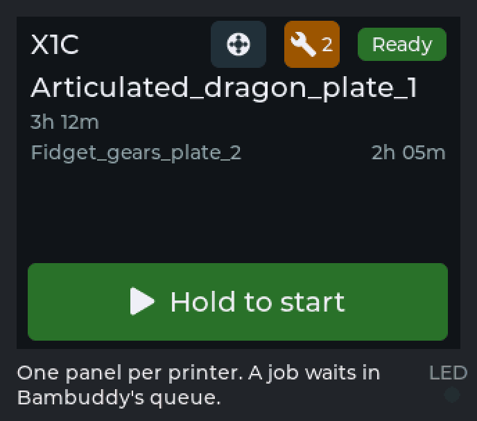
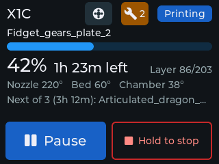
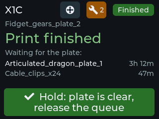
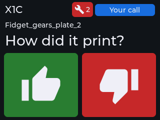
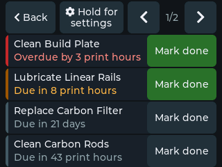

---
hide:
  - navigation
  - toc
---

# Bambuddy Panel

A small touch panel that sits next to a 3D printer and shows what
[Bambuddy](https://github.com/maziggy/bambuddy) knows about it, with the few actions you want
while standing there. No phone, no browser tab.

[Get started](get-started.md){ .btn .btn-primary }
[What it does](using.md){ .btn .btn-secondary }

<video autoplay loop muted playsinline controls>
  <source src="demo.webm" type="video/webm">
  <source src="demo.mp4" type="video/mp4">
  
</video>

One panel per printer. It runs on the inexpensive ESP32-2432S028R ("Cheap Yellow Display") and
talks only to your Bambuddy server over WiFi, never to the printer or to any cloud. Available status fields and controls depend on the printer and Bambuddy version.

*The film is a minute with the panel, from the simulator: the panel's own screens, a made-up
printer. The dot is a finger, the lamp under the screen is the LED on the board's back.*

!!! warning "Status: early"

    It runs on one board, the ESP32-2432S028R with the ST7789 display (`cyd-st7789`): display,
    touch calibration, WiFi and Bambuddy setup, status, and the filament slots of a real
    printer. The buttons' commands (pause, stop, plate is clear, start and the rest) are
    checked by native request tests, but **have not all been pressed against a
    real Bambuddy yet**, and no other board has been flashed. Expect rough edges until this
    note goes away.

## Where to start

### [:material-rocket-launch: Get started](get-started.md)
What to buy, how to flash it, the API key, setup.

### [:material-gesture-tap: Using the panel](using.md)
What each screen shows and what its buttons do.

### [:material-update: Updating](updating.md)
A new release onto a panel, without USB.

### [:material-developer-board: Boards](boards.md)
Which boards have a build, and which have been tried.

### [:material-lifebuoy: Troubleshooting](troubleshooting.md)
A wrong picture, a touch that is off, no answer from Bambuddy.

### [:material-shield-lock: Security](security.md)
Where the API key is, and who can change what.

### [:material-api: How it talks to Bambuddy](api.md)
Every request it makes.

### [:material-hammer-wrench: Development](development.md)
Building, the simulator, the tests.

## What it does, in short

The panel offers what only Bambuddy can do, and the few printer controls that are slow to reach
on a printer's own screen. Everything else (temperatures to set, speed, the light, the AMS) is
left to the printer.

| Printing | Print finished | Outcome question | Maintenance |
|---|---|---|---|
| { .screenshot } | { .screenshot } | { .screenshot } | { .screenshot } |

*Screenshots are from the simulator, at the panel's real 320x240.*

- Pause, resume and stop a print.
- **Plate is clear** releases the plate gate. Bambuddy decides when a queued job can start.
- Bambuddy's *Ask for outcome* question, with a thumbs up or down.
- Start a job that waits for a manual start; resume a queue held after a failed print.
- The printer's error in words, and clearing it.
- The filament slots, and assigning a spool of Bambuddy's inventory to one.
- Maintenance tasks, most urgent first, and marking them done.
- An LED that blinks when someone should come over.

Start, Stop, Resume queue and Plate is clear take a 1.5-second hold. Pause and Resume take one tap.

## Not done yet

- Every button pressed against a real Bambuddy, a first run of the boards other than
  `cyd-st7789`, and fixing what those turn up.
- Lock or PIN on the controls.
- Switching the printer on through its smart plug, and holding the next queued job back:
  both need checking against a running Bambuddy first (`docs/ux-deep-dive-plan.md` in the repository, 3.4).
- Spool assignment when Bambuddy keeps its spools in Spoolman.
- Accented letters (Latin-1 fonts); the finish time as a clock time.
- Backlight dimming from the light sensor.
- A browser flasher, so nobody needs a command line to try it.
- Signed firmware, and going back to the old firmware by itself when a new one doesn't work.
- Telling you that a newer release exists.
- A printable case.

## License

MIT, see [LICENSE](https://github.com/loidolt/bambuddy-panel/blob/main/LICENSE). Icons and libraries:
[THIRD_PARTY.md](https://github.com/loidolt/bambuddy-panel/blob/main/THIRD_PARTY.md).

Bambuddy Panel is an independent community project. It is not part of, or endorsed by, Bambuddy
or Bambu Lab.
