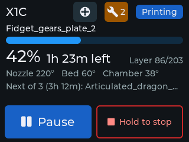
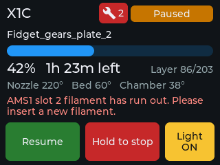
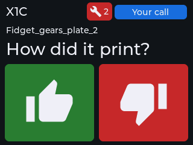
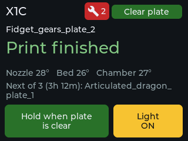

# Using the panel

The status label in the header names the current state. **Tap** a button for an immediate action.
**Hold** buttons fill over 1.5 seconds and act when full. Release early to cancel. Use the printer’s
own controls to set temperatures, change print speed or operate its light.

## Status and controls

| Screen | What you can do |
|---|---|
| **Starting** | Wait while Bambuddy sends the queued job to the printer. |
| **Preparing** or **Printing** | Tap **Pause** or hold to stop. Preparing shows the current stage. Printing shows progress, time left and, when available, layer and temperatures. |
| **Paused** | Read any reported error. Tap **Resume** or hold to stop. |
| **Finished** with “How did it print?” | Tap thumbs up, thumbs down or **Skip**. |
| **Finished** or **Failed** with a plate prompt | Remove the print, check the plate, then hold to confirm it is clear. |
| **Ready** | Check the job name and any reason Bambuddy gives for waiting. Hold to start the staged job. |
| **Queue held** | Hold to resume jobs that Bambuddy skipped after a failed or aborted print. This action can also appear on **Ready** and **Error**. |
| **Error** | Tap the error text to cycle through up to three messages. Tap **Clear error** to request a clear after addressing the cause. |
| **Idle** | See up to three queued jobs and why the first is waiting. Bambuddy picks the printer for jobs queued to any printer of a model. |
| **Printer offline** | Bambuddy is reachable but has lost contact with the printer. Check the printer’s power and connection. |

{ .screenshot }
{ .screenshot }

The panel sends one action at a time. It checks that the job, slot or task still matches what you
selected, then reads status again after the request. If the screen says **Status changed**, check
the new state before retrying. A red message identifies a failed request and stays visible for six
seconds or until tapped.

## Print outcomes and the queue

The outcome question appears for a completed, unanswered print for which **Ask for outcome** was
enabled. **Skip** dismisses the question locally for that run. A permission denial also suppresses
the prompt for that run. Bambuddy can count unanswered outcomes as good when the plate is released,
so record the outcome before clearing the plate if you want it counted a particular way.

**Plate is clear** appears when Bambuddy is waiting for confirmation and
**Require plate-clear confirmation** is enabled. It can appear even after the printer powers off.
Releasing the plate allows Bambuddy to consider the next job. Filament, review, timing or printer
availability can still delay it. **Hold to start** applies to a manual-start job assigned to this
printer.

{ .screenshot }
{ .screenshot }

## Filament and maintenance

Tap the **spool** to see the reported filament in each slot, its assigned inventory spool and the
remaining weight when known. Tap **Change** or **Assign** beside a slot. The material button cycles
through filters, including **All types**. Hold **Assign** beside a spool to move its assignment to
this slot. Hold **Remove** to clear the inventory assignment. Use the printer’s controls to load or
unload the physical filament. The inventory change can succeed while the printer’s tray
configuration is still pending.

The spool icon appears on printers that report slots. The panel uses Bambuddy’s built-in inventory.
Spoolman integration is unavailable. It shows up to 18 slots in total, including up to two external
holders, and the first 150 inventory spools. Larger or multi-nozzle layouts may be incomplete.

Tap the **wrench** to see up to 12 enabled maintenance tasks, most urgent first. An amber outline
means tasks are due soon. A filled amber badge means at least one is due. After performing a task,
hold **Mark done** to record it. Press **Hold for settings** until the bar fills to
[reopen setup](get-started.md#reopen-settings). Both the filament and maintenance screens return to
status after a minute of inactivity.

## LED and backlight

On boards with an RGB LED, solid blue means a job is starting, preparing or printing. A blinking LED
indicates a state you may need to act on.

| Blinking colour | Meaning |
|---|---|
| Cyan | A print is waiting for an outcome |
| Green | The plate needs clearing |
| Yellow | The print is paused or the queue is held |
| Red | The panel is on the Error screen |
| Purple | The panel has lost contact with Bambuddy or needs its connection settings checked |

On boards with a dimmable backlight, the status screen drops to 35% brightness after a minute of
inactivity while starting, preparing, printing, idle or showing a disconnected printer. The first
touch wakes it. For a grey status label, missing button or connection warning, see
[Troubleshooting](troubleshooting.md).
