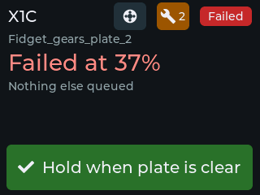

# Using the panel

The panel offers what only Bambuddy can do, and the few printer controls that are slow to reach
on a printer's own screen. Everything else (temperatures to set, speed, the light, the AMS) is
left to the printer.

The screen follows the printer's state. A chip in the corner names it; the buttons are what
can be done about it:

| State | The screen shows | Buttons |
|---|---|---|
| Preparing | The stage it is at ("Auto bed leveling") | Pause, Stop (hold) |
| Printing | Progress, time left, layer, temperatures, what is next | Pause, Stop (hold) |
| Paused | Where it paused, and the error if there is one | Resume, Stop (hold) |
| Finished, and the print was started with *Ask for outcome* | "How did it print?" | Thumbs up, Thumbs down, Skip |
| Finished or failed, plate not yet cleared, and Bambuddy's *Require plate clear* is on | The result and up to two queued jobs | Plate is clear (hold) |
| Error | The error's text; with several, a tap shows the next | Clear error |
| Ready: the next job for this printer waits for a manual start | The job, how long it takes, who queued it, and why Bambuddy holds it back if it does | Start (hold) |
| Queue held: Bambuddy held jobs back because a print failed | How many | Resume queue (hold) |
| Idle | The next three jobs, and what the first is waiting for | none |

A **Resume queue** button also joins Error and Ready when jobs are held.

- **Hold** buttons fill from the left over 1.5 seconds and act when full; letting go early does
  nothing. Pause, Resume, Clear error and the outcome buttons are taps.
- A pressed button says what is under way ("Stopping...") and further writes wait for the reply and another status poll. A command that fails says why in a red band across the top,
  which stays six seconds or until it is tapped: "Access denied (Manage Queue)", "Not enough
  filament loaded".
- The **outcome question** comes before "plate is clear" on purpose: Bambuddy can be set to
  record an unanswered print as good when the plate is cleared. It is asked, as on Bambuddy's own
  printer card, only for prints that completed. **Skip** passes it for that print and goes on to
  the plate; it can still be answered in Bambuddy. If the API key may not record the answer,
  the panel says so once and stops asking.
- **Plate is clear** is offered only when Bambuddy's *Require plate clear* setting is on (as in
  Bambuddy's own UI), and also while the printer is switched off, as it is with Auto Power Off.
  Clearing the plate releases one scheduling condition. Filament, review, timing or printer availability can still delay the next job.
- **Start** is offered only for a job assigned to this printer. A job queued for "any X1C" shows
  as waiting, with a line saying Bambuddy picks the printer.
- The **spool** in the header opens the printer's filament slots: what the printer says is in
  each, and which spool of Bambuddy's inventory is assigned to it, with what is left on it.
  **Change** or **Assign** on a slot lists the inventory's spools, starting with the material
  that is in the slot; the button at the top steps through the other materials. Hold **Assign**
  on a spool to move its inventory assignment. Printer configuration can remain pending; hold **Remove** to take the slot's spool out.
  The spool only shows for a printer that reports slots. This uses Bambuddy's own inventory;
  Spoolman is not supported yet. The panel keeps up to 18 slots, two external holders and the first 150 inventory spools. Multi-nozzle and larger slot layouts can be incomplete.
- The **wrench** in the header opens the printer's maintenance tasks, most urgent first. It
  turns amber with a count when tasks are due and gets an amber outline when some are due
  soon. Hold **Mark done** to mark a task performed. The list returns to the status screen
  after a minute without a touch. Press **Hold for settings** for 1.5 seconds to open setup. A bar fills along the bottom edge as you hold.
- On boards fitted with an RGB **LED**, it blinks when someone should come over: cyan for the outcome question,
  green for "clear the plate", yellow for paused or a held queue, red for an error, purple when
  Bambuddy can't be reached. Solid blue while preparing, sending or printing.
- The **backlight** dims to about a third after a minute without a touch while nothing wants
  anyone (printing, idle, printer offline). The first touch on a dimmed screen only brightens it.
- **Error** means what Bambuddy's own printer card counts as a problem. Notices the printer
  keeps for a whole print ("the top cover is open") and codes Bambu publishes no text for are
  left out, as they are there.
- One request Bambuddy doesn't answer greys the chip: what is on screen may be a few seconds
  old. From the second in a row a red band says for how long there has been no answer, the
  last status stays under it, and printer controls are disabled. Local navigation and setup remain available. After five minutes, or at once when
  Bambuddy refuses the key or the address can't work, a screen says why and offers
  **Open settings**.
- The panel's fonts only have plain ASCII, so names are shown without accents (*Jürgen* becomes
  *Jurgen*); other scripts show as `?`.

## More screens

| Idle | Paused with an error | Print failed |
|---|---|---|
| { .screenshot } | { .screenshot } | { .screenshot } |

Settings, and how to get back into them, are under
[Get started](get-started.md#set-up-a-panel).
